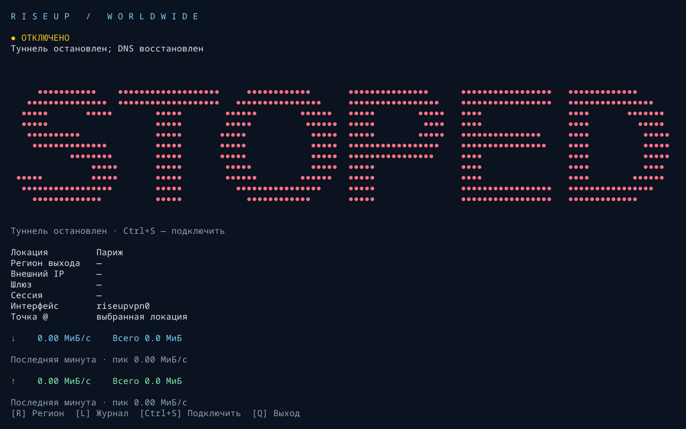

# Riseup VPN Panel



Терминальная панель в стиле ASCII/Fastfetch: карта мира из географических
контуров, подсветка страны, выбор бесплатных локаций Riseup, проверенный
внешний IP, текущая скорость и графики трафика. Аккаунт Riseup не нужен.

**Ctrl+S** останавливает туннель, восстанавливает сеть и оставляет панель
открытой с большим точечным **STOPED**. Повторное Ctrl+S подключает выбранный
регион заново. **R** — выбор региона, **L** — журнал, **Q** — выход после остановки.
Ctrl+C тоже останавливает туннель без закрытия панели. В текстовом режиме
Ctrl+C завершает обычный скрипт. Для Ctrl+S отключается XON/XOFF и
восстанавливается исходный режим терминала при выходе.

Регионы: Амстердам (NL), Париж (FR), Монреаль (CA), Нью-Йорк, Майами и Сиэтл (US).
Шлюзы берутся из TLS-защищённого каталога Riseup при подключении. Наличие
города в меню не гарантирует доступность его серверов. При недоступном
каталоге только исходный Amsterdam backend имеет два сохранённых адреса.

Город и подсветка — выбранная конфигурация. Страна выхода подтверждается
HTTPS-проверкой через туннель; до совпадения страны статус «Подключено»
и внешний IP не показываются. На мелких границах выделяются только точки
выбранной страны, а не целиком символы, содержащие соседние территории.

## Состояние поддержки

| Система | Сетевой backend | Проверено |
|---|---|---|
| Steam Deck / SteamOS, Linux x86_64 | Исходный встроенный OpenVPN | Linux: изолированные тесты, PTY и обработчик DNS; реальная сеть здесь недоступна |
| macOS Intel / Apple Silicon | Нативный OpenVPN 2.6 из установленного Tunnelblick | Подготовлен исходный порт; синтаксис и общие тесты. Нужна проверка туннеля на Mac |
| Windows 10/11 | OpenVPN Community GUI + Interactive Service | Подготовлен исходный порт; генерация профиля и общие тесты. Нужна проверка туннеля на Windows |

Это независимая панель, не официальный клиент Riseup. Встроенный Linux ELF
не используется и не запускается на Windows/macOS. Автоматического
kill switch при аварии приложения нет; проверка страны не является
заявлением о полной защите от всех видов утечек.

## Steam Deck: запуск без пароля

Файлы уже установленной версии должны лежать в `~/.local/share/riseup-vpn`.
Для установки из репозитория:

```bash
mkdir -p "$HOME/.local/share/riseup-vpn"
install -m 700 Riseup-Amsterdam-SteamDeck.sh riseup-panel.py riseup_regions.py \
  world_map.py stoped_title.py install-passwordless.sh "$HOME/.local/share/riseup-vpn/"
install -m 600 world-land.json stoped-mask.json "$HOME/.local/share/riseup-vpn/"
bash "$HOME/.local/share/riseup-vpn/install-passwordless.sh"
```

**Однократная установка системного правила требует прав администратора.**
После успешной установки запуск и переключение регионов используют `sudo -n`
без запроса пароля. Пароль учётной записи deck не изменяется.
NOPASSWD разрешён только защищённому root-owned backend и фиксированным
аргументам; пользовательская копия кода не получает произвольные права root.

Если предыдущая версия отвечала `sudo: требуется указать пароль`, повторите
установку: правило теперь называется `zz-riseup-vpn` и читается после
штатного `wheel`. Старое `70-riseup-vpn` переносится в резервную копию.
Установщик проверяет не только синтаксис `visudo`, но и реальный запуск
без пароля от deck с игнорированием сохранённого timestamp. Он не сообщает
об успехе, если эта проверка не пройдена.

Алиасы zsh:

```bash
alias vpn='bash "$HOME/.local/share/riseup-vpn/Riseup-Amsterdam-SteamDeck.sh"'
alias VPN='bash "$HOME/.local/share/riseup-vpn/Riseup-Amsterdam-SteamDeck.sh"'
```

`vpn --region paris` — сразу выбрать Париж; `vpn --text --region seattle` —
текстовая диагностика. Все идентификаторы: amsterdam, paris, montreal,
newyork, miami, seattle. Подробнее: [README-panel.md](README-panel.md).

## macOS

Требуются Python 3.11+, Apple Command Line Tools (`xcode-select --install`)
и [Tunnelblick](https://tunnelblick.net/) с OpenVPN 2.6. Приложение Tunnelblick
используется как источник нативного OpenVPN; его VPN-профили не изменяются.

```bash
bash platforms/macos/install.sh   # один административный запрос
./start-macos.command
```

Первый запуск создаёт пользовательский venv и ставит psutil. Установщик
копирует Tunnelblick в защищённый root-owned каталог вместе с backend,
сертификатом CA и DNS-hook. Разрешение sudo ограничено фиксированными
регионами. Смена региона и Ctrl+S не требуют повторного ввода пароля.
Системный `/usr/bin/python3` нужен только для разбора каталога шлюзов.

Счётчики берутся у фактического `utunN`, о котором сообщает OpenVPN.
DNS-hook сохраняет настройки сетевых служб, ставит DNS Riseup и возвращает
предыдущие значения после остановки; изменения, сделанные другим
приложением во время VPN-сессии, не перезаписываются.

## Windows 10/11

1. Установите Python 3.11+ и [OpenVPN Community](https://openvpn.net/community-downloads/)
   с OpenVPN GUI, Wintun и Interactive Service.
2. Один раз откройте PowerShell от администратора:

   ```powershell
   powershell -ExecutionPolicy Bypass -File .\platforms\windows\install.ps1 -User "COMPUTER\username"
   ```

3. После изменения членства в `OpenVPN Administrators` выйдите из учётной
   записи и войдите снова. Запускайте `start-windows.cmd` обычным пользователем.
   Первый запуск ставит windows-curses и psutil в пользовательский venv.

Панель управляет только профилем `RiseupVPN-Panel` через официальный GUI;
служба OpenVPN выполняет настройку и откат DNS/маршрутов. Панель не
запрашивает UAC для каждого подключения и не требует удаления пароля Windows.
Профиль и временный сертификат хранятся в защищённой ACL папке текущего
пользователя; чужой одноимённый профиль не перезаписывается. После
подтверждения остановки временный приватный ключ удаляется.
Для корректного закрытия используйте Ctrl+S, затем Q.

## Проверки и ограничения

```bash
python3 -m unittest discover -s tests -v
```

На Linux выполнены 26 тестов без реальных сетевых изменений. Они покрывают
тайм-аут сертификата, загрузку/отказ каталога, резервный шлюз, шесть регионов,
проверку страны, счётчики, восстановление тестового DNS, PTY/resize,
Ctrl+S stop/restart, запрет смены региона без cleanup, карту и dot-надпись,
точные правила sudoers и генерацию нативного профиля Windows.
Общие тесты для нативных платформ:

```bash
python -m unittest discover -s tests -p test_portable.py -v
```

GitHub Actions запускает Linux-тесты и общие тесты на macOS/Windows.
CI не открывает VPN-туннели и не меняет сеть runners. Реальные сетевые
испытания на Windows/macOS обязательны перед использованием этих портов
как проверенной замены официального клиента.

Логи панели фильтруют PEM-блоки. Никогда не коммитьте client.pem,
приватные ключи, временные сертификаты и сгенерированные профили.
Скорость — текущий трафик интерфейса, а не история всего VPN-аккаунта;
используется фактически прошедшее монотонное время. МиБ = 1024² байт.

Карта — Natural Earth (public domain). Надпись STOPED — готовая растровая
маска жирной гротескной гарнитуры с плотным интервалом; файлы шрифтов
не распространяются. Проектный код — MIT; OpenVPN и сторонний runtime
имеют собственные лицензии, см. [SOURCES.md](SOURCES.md),
[notices](assets/LINUX-RUNTIME-NOTICES.md) и `bash Riseup-Amsterdam-SteamDeck.sh --licenses`.
