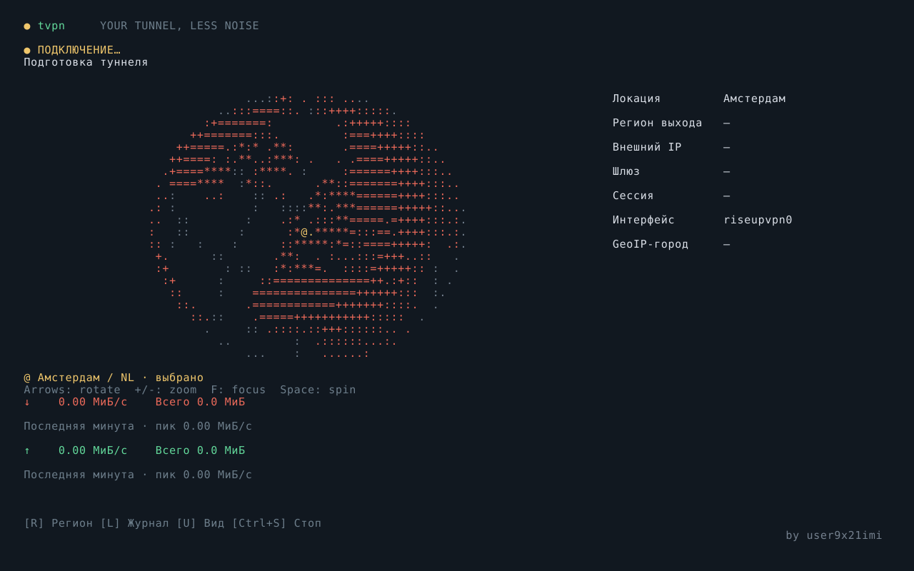

```text
+----------------------------------------------------------------------------+
| ##### #   # ####  #   #                                                    |
|   #   #   # #   # ##  #                                                    |
|   #   #   # #   # ##  #                                                    |
|   #   #   # ####  # # #                                                    |
|   #   #   # #     #  ##                                                    |
|   #    # #  #     #  ##                                                    |
|   #     #   #     #   #                                                    |
|                                                                            |
| TVPN / FREE VPN / LINUX + macOS + WINDOWS                                  |
+----------------------------------------------------------------------------+
```




[Обложка для карточки ссылки: Riseup VPN](assets/social-preview.png)

```text
+------------------------- CONTROL PANEL -------------------------+
| Ctrl+S : CONNECT / STOP   | R : REGION | L : LOG | Q : EXIT       |
+-----------------------------------------------------------------+
|  NL / Amsterdam  FR / Paris  CA / Montreal                        |
|  US / New York   US / Miami  US / Seattle                         |
+-----------------------------------------------------------------+
```


```text
+-------------------------- ASCII GLOBE -------------------------+
| Arrows : camera       + / - : zoom      mouse wheel : zoom      |
| Space  : spin/pause    F     : focus selected VPN city          |
+---------------------------------------------------------------+
```

Глобус заменяет плоскую карту. При выборе региона камера плавно
поворачивается к его городу, а страна подсвечивается точками: жёлтым до
проверки выхода и зелёным после неё. Стрелки вращают камеру, `+`/`-` и
колесо мыши меняют масштаб, пробел включает/выключает вращение,
`F` возвращает камеру к выбранному региону. Эти действия не меняют VPN
и не трогают маршруты. После Ctrl+S вместо глобуса остаётся STOPED.

Поведение вдохновлено [globe-cli](https://github.com/adam-wier/globe).
Встроенный рендерер TVPN работает на Python без Rust, cargo и дополнительных
бинарных зависимостей. Геометрия стран — Natural Earth. Используются только
обычные ASCII-символы, что сохраняет совместимость с Terminal.app.

```text
+---------------------- UPDATE AVAILABLE -----------------------+
| New version detected.                                         |
| Update now?  [Y] Yes / Да   [N] No / Нет                        |
| No = continue. Yes = stop VPN -> verify -> update -> restart.   |
+---------------------------------------------------------------+
```

TVPN проверяет обновления в фоне при запуске и затем раз в час. При новой
версии появляется подтверждение **Yes / No**. `No` оставляет текущую версию
и туннель работающими; повторно о той же версии в этом запуске не спрашивает.
`Yes` сначала штатно останавливает VPN и ждёт восстановления сети, затем
скачивает архив по HTTPS, проверяет SHA256 и версию, устанавливает файлы и
перезапускает панель с выбранным регионом. Если проверка/установка не удалась,
текущая версия сохраняется. Пользовательские настройки и `.venv` не заменяются.

Если меняется защищённый сетевой backend, ОС отдельно запросит разрешение
администратора. Для обычного обновления интерфейса оно не требуется.
Проверку можно отключить переменной `RISEUP_NO_UPDATE_CHECK=1`.
Старые установки без функции обновлений нужно один раз обновить обычным
установщиком; после этого будущие версии предлагаются автоматически.

Терминальная панель в стиле ASCII/Fastfetch: интерактивный ASCII-глобус из географических
контуров, подсветка страны, выбор бесплатных локаций Riseup, проверенный
внешний IP, текущая скорость и графики трафика. Аккаунт Riseup не нужен.

**Ctrl+S** останавливает туннель, восстанавливает сеть и оставляет панель
открытой с большим точечным **STOPED**. Повторное Ctrl+S подключает выбранный
регион заново. **R** — выбор региона, **L** — журнал, **U** — ASCII/Unicode, **Q** — выход после остановки.
Ctrl+C тоже останавливает туннель без закрытия панели. В текстовом режиме
Ctrl+C завершает обычный скрипт. Для Ctrl+S отключается XON/XOFF и
восстанавливается исходный режим терминала при выходе.

В меню известны Амстердам (NL), Париж (FR), Монреаль (CA), Нью-Йорк,
Майами и Сиэтл (US). Доступность определяется живым каталогом Riseup.
На 17 ноября 2026 года доступны Амстердам (3 шлюза), Париж (9), Монреаль (2)
и Майами (2). Нью-Йорк и Сиэтл присутствуют в метаданных провайдера,
но шлюзов для них нет: они помечаются «нет шлюзов Riseup» и не подключаются.
Шлюзы берутся из TLS-защищённого каталога Riseup при подключении. Наличие
города в меню не гарантирует доступность его серверов. При недоступном
каталоге только исходный Amsterdam backend имеет два сохранённых адреса.

Город шлюза и подсветка — выбранная конфигурация. Отдельная строка
«GeoIP-город» показывает город из базы ipwho.is: он может отличаться от
названия шлюза (например, Haarlem вместо Amsterdam) и не доказывает
физическое расположение сервера. Страна выхода проверяется через туннель
по Cloudflare HTTPS trace и независимому HTTPS GeoIP-ответу для того же IP.
При расхождении страны или недоступности независимой проверки подключение
не подтверждается. Проверка не выбирает другой город/страну молча; до совпадения страны статус «Подключено»
и внешний IP не показываются. На мелких границах выделяются только точки
выбранной страны, а не целиком символы, содержащие соседние территории.

```text
+---------------------------+
|  [ Состояние поддержки ]  |
+---------------------------+
```

| Система | Сетевой backend | Проверено |
|---|---|---|
| Linux x86_64 | Исходный встроенный OpenVPN | Linux: изолированные тесты, PTY и обработчик DNS; реальная сеть здесь недоступна |
| macOS Intel / Apple Silicon | Нативный OpenVPN 2.6 из Tunnelblick (автоустановка) | Подготовлен исходный порт; синтаксис и общие тесты. Нужна проверка туннеля на Mac |
| Windows 10/11 | OpenVPN Community GUI + Interactive Service | Подготовлен исходный порт; генерация профиля и общие тесты. Нужна проверка туннеля на Windows |

Это независимая панель, не официальный клиент Riseup. Встроенный Linux ELF
не используется и не запускается на Windows/macOS. Автоматического
kill switch при аварии приложения нет; проверка страны не является
заявлением о полной защите от всех видов утечек.

```text
+--------------------------------+
|  [ Linux: запуск без пароля ]  |
+--------------------------------+
```

Файлы уже установленной версии должны лежать в `~/.local/share/riseup-vpn`.
Для установки из репозитория:

```bash
mkdir -p "$HOME/.local/share/riseup-vpn"
install -m 700 Riseup-Amsterdam-SteamDeck.sh riseup-panel.py riseup_regions.py \
  world_map.py stoped_title.py verify_exit.py install-passwordless.sh "$HOME/.local/share/riseup-vpn/"
install -m 600 world-land.json stoped-mask.json "$HOME/.local/share/riseup-vpn/"
bash "$HOME/.local/share/riseup-vpn/install-passwordless.sh"
```

**Однократная установка системного правила требует прав администратора.**
После успешной установки запуск и переключение регионов используют `sudo -n`
без запроса пароля. Пароль учётной записи deck не изменяется.
NOPASSWD разрешён только защищённому root-owned backend и фиксированным
аргументам; пользовательская копия кода не получает произвольные права root.

Если предыдущая версия отвечала `sudo: требуется указать пароль`, повторите
установку: правило теперь называется `zz-riseup-vpn` и читается после
штатного `wheel`. Старое `70-riseup-vpn` переносится в резервную копию.
Установщик проверяет не только синтаксис `visudo`, но и реальный запуск
без пароля от deck с игнорированием сохранённого timestamp. Он не сообщает
об успехе, если эта проверка не пройдена.

Команда **tvpn** запускает панель. На macOS ярлык и alias создаются
автоматически. Для Linux установите его в пользовательский PATH:

```bash
mkdir -p "$HOME/.local/bin"
install -m 700 bin/tvpn "$HOME/.local/bin/tvpn"
```

Алиасы zsh:

```bash
alias vpn='bash "$HOME/.local/share/riseup-vpn/Riseup-Amsterdam-SteamDeck.sh"'
alias VPN='bash "$HOME/.local/share/riseup-vpn/Riseup-Amsterdam-SteamDeck.sh"'
```

`vpn --region paris` — сразу выбрать Париж; `vpn --text --region seattle` —
текстовая диагностика. Все идентификаторы: amsterdam, paris, montreal,
newyork, miami, seattle. Подробнее: [README-panel.md](README-panel.md).

```text
+-------------+
|  [ macOS ]  |
+-------------+
```

**[Скачать установщик macOS](https://github.com/user9x21imi/riseup-vpn-panel/raw/refs/heads/main/assets/RiseupVPN-macOS-Installer.zip)**

Распакуйте ZIP и дважды щёлкните `Install-RiseupVPN.command`. Он скачает проект,
установит недостающие Python и Tunnelblick, создаст окружение, обновит
защищённый backend и сразу запустит панель. Вводить команды или отдельно
устанавливать Command Line Tools не нужно. При первой установке/обновлении
macOS один раз запросит администратора; последующие подключения — без пароля.
При первом открытии неподписанного .command macOS может потребовать разрешить
его через контекстное меню «Открыть»; Gatekeeper установщик не отключает.

Если репозиторий уже скачан — достаточно двойного щелчка по
`start-macos.command`. Он автоматически замечает старую защищённую копию
backend и обновляет её. Ярлык создаётся в `~/Applications/TVPN.command`.
Автоматическая загрузка свежего Tunnelblick рассчитана на macOS 13+;
на более старой системе нужен совместимый Tunnelblick с OpenVPN 2.6.

Для совместимости с Terminal.app на Mac по умолчанию используется обычный
ASCII для карты, графиков и точечной надписи. `U` переключает ASCII/Unicode;
настройка действует при смене регионов в текущем запуске. UTF-8 locale
устанавливается явно, но поддержка Braille шрифтом больше не обязательна.

Установщик загружает зависимости только с официальных HTTPS-адресов,
проверяет подписи Python Software Foundation и Tunnelblick, а также
SHA256 закреплённого DMG Tunnelblick. Привилегированный код и OpenVPN
хранятся в защищённом root-owned каталоге. Homebrew Python и библиотеки
из пользовательского каталога не запускаются с NOPASSWD.

Счётчики берутся у фактического `utunN`. DNS-hook сохраняет и восстанавливает
настройки служб; сторонние изменения во время сессии не перезаписывает.


```text
+---------------------+
|  [ Windows 10/11 ]  |
+---------------------+
```

1. Установите Python 3.11+ и [OpenVPN Community](https://openvpn.net/community-downloads/)
   с OpenVPN GUI, Wintun и Interactive Service.
2. Один раз откройте PowerShell от администратора:

   ```powershell
   powershell -ExecutionPolicy Bypass -File .\platforms\windows\install.ps1 -User "COMPUTER\username"
   ```

3. После изменения членства в `OpenVPN Administrators` выйдите из учётной
   записи и войдите снова. Запускайте `start-windows.cmd` обычным пользователем.
   Первый запуск ставит windows-curses и psutil в пользовательский venv.

Панель управляет только профилем `RiseupVPN-Panel` через официальный GUI;
служба OpenVPN выполняет настройку и откат DNS/маршрутов. Панель не
запрашивает UAC для каждого подключения и не требует удаления пароля Windows.
Профиль и временный сертификат хранятся в защищённой ACL папке текущего
пользователя; чужой одноимённый профиль не перезаписывается. После
подтверждения остановки временный приватный ключ удаляется.
Для корректного закрытия используйте Ctrl+S, затем Q.

```text
+------------------------------+
|  [ Проверки и ограничения ]  |
+------------------------------+
```

```bash
python3 -m unittest discover -s tests -v
```

На Linux выполнены 61 тест без реальных сетевых изменений. Они покрывают
тайм-аут сертификата, загрузку/отказ каталога, резервный шлюз, шесть регионов,
проверку страны, счётчики, восстановление тестового DNS, PTY/resize,
Ctrl+S stop/restart, запрет смены региона без cleanup, карту и dot-надпись,
точные правила sudoers и генерацию нативного профиля Windows.
Общие тесты для нативных платформ:

```bash
python -m unittest discover -s tests -p test_portable.py -v
```

GitHub Actions запускает Linux-тесты и общие тесты на macOS/Windows.
В тестах дополнительно воспроизведены отсутствие NYC/Seattle в реальном
каталоге, неправильный hostname города, блокировка UDP с переходом на TCP,
несовпадение GeoIP-страны, обычный ASCII на Mac и единый установщик.
CI не открывает VPN-туннели и не меняет сеть runners. Реальные сетевые
испытания на Windows/macOS обязательны перед использованием этих портов
как проверенной замены официального клиента.

Логи панели фильтруют PEM-блоки. Никогда не коммитьте client.pem,
приватные ключи, временные сертификаты и сгенерированные профили.
Скорость — текущий трафик интерфейса, а не история всего VPN-аккаунта;
используется фактически прошедшее монотонное время. МиБ = 1024² байт.

Карта — Natural Earth (public domain). Надпись STOPED — готовая растровая
маска жирной гротескной гарнитуры с плотным интервалом; файлы шрифтов
не распространяются. Проектный код — MIT; OpenVPN и сторонний runtime
имеют собственные лицензии, см. [SOURCES.md](SOURCES.md),
[notices](assets/LINUX-RUNTIME-NOTICES.md) и `bash Riseup-Amsterdam-SteamDeck.sh --licenses`.

```text
+-------------------------- SOURCE TREE ---------------------------+
| launch.py                  -> native platform launcher           |
| riseup-panel.py            -> terminal interface                  |
| world_map.py               -> country geometry + map rendering    |
| stoped_title.py            -> tightly spaced STOPED dots          |
| platforms/macos/           -> native OpenVPN + DNS hooks          |
| platforms/windows/         -> OpenVPN Interactive Service bridge  |
| assets/                    -> maps, previews, public CA            |
| tests/                     -> isolated verification               |
+-----------------------------------------------------------------+
```

```text
+----------------------- RELEASE UPDATE ------------------------+
| python3 tools/build_update.py --version X.Y.Z                  |
+---------------------------------------------------------------+
```

Для выпуска следующей версии увеличьте номер, выполните команду и
опубликуйте вместе `VERSION`, `update.json`, `assets/updates/X.Y.Z.zip`
и исходники. Обычный коммит без увеличения версии не вызывает предложение
обновления. Манифест лежит отдельно от архива, поэтому SHA256 не содержит
циклической ссылки на себя. Проверки обновления не требуют Git или gh у пользователя.

GitHub Release создаётся автоматически после успешного CI на Linux, macOS и Windows.
Архив проверяется по SHA256 перед публикацией; готовый релиз доступен в Releases.
